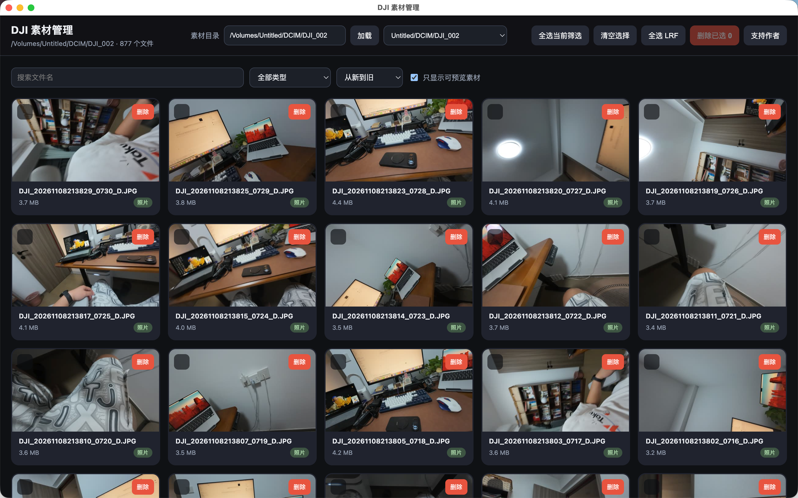
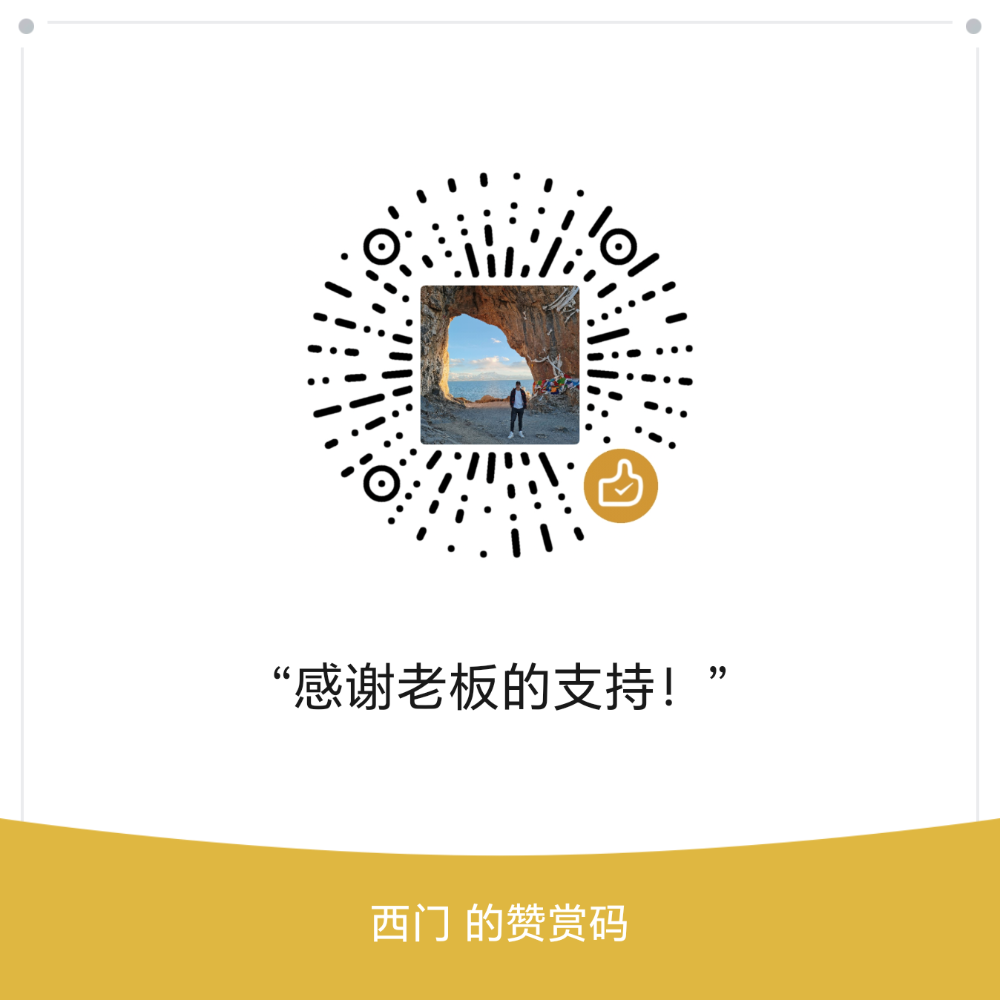

# DJI 素材管理器

浏览 DJI Action 4 等相机存储卡素材，安全批量清理低价值文件。



## 功能

- 自动发现存储卡：
  - macOS：`/Volumes/<卡名>/DCIM/*`
  - Windows：`A:\` 到 `Z:\` 下的 `DCIM/*`
- 手动输入任意绝对路径
- 图片 / 视频缩略图懒加载
- 大图、视频预览，左右键切换
- 搜索、类型筛选、按时间或大小排序
- 单选、批量选择、一键选择 LRF 低码率代理文件
- 默认直接从设备删除，不可恢复，操作前请确认已备份
- 确认框可取消勾选“直接删除”，尝试移入系统回收站 / 废纸篓；部分可移动存储卡不支持
- 页面渲染与缩略图生成有限流，避免大卡素材卡死

## 安装

### macOS

从 GitHub Releases 下载对应架构：

- Apple Silicon：`DJI 素材管理器-<version>-arm64.dmg`
- Intel：`DJI 素材管理器-<version>-x64.dmg`

未签名版本首次打开：

1. 把 App 拖入 `/Applications`
2. 右键 App → **打开**
3. 如果 macOS 仍提示，可在终端执行：

```bash
xattr -dr com.apple.quarantine "/Applications/DJI 素材管理器.app"
```

### Windows

从 GitHub Releases 下载：

- 安装版：`DJI 素材管理器 Setup <version>.exe`
- 免安装版：`DJI 素材管理器 <version>.exe`

未签名 EXE 可能出现 SmartScreen 或杀毒软件提示：

1. 点击 **更多信息**
2. 点击 **仍要运行**
3. 如杀毒软件误报，请在 Release 页核对 SHA256 后添加信任或上报误报

### ffmpeg

安装包已内置 `ffmpeg-static` 提供的 ffmpeg 6.0 可执行文件，普通用户无需另外安装。

内置 ffmpeg 采用 GPL 相关许可。本项目代码为 MIT，但捆绑的二进制遵守其自身许可；详细来源与义务见 [`NOTICE.md`](NOTICE.md)。

如你希望自己提供 ffmpeg，也可以：

- 设置环境变量 `FFMPEG_PATH` 指向可执行文件
- 或让 `ffmpeg` 出现在系统 `PATH` 中

应用会按以下顺序选择 ffmpeg：

1. `FFMPEG_PATH`
2. 内置二进制
3. 系统 `PATH`

图片缩略图在 macOS 可使用系统 `sips`；跨平台一致性建议保留内置 ffmpeg。

## 校验下载文件

每个 Release 都提供 `SHA256SUMS`。

macOS / Linux：

```bash
shasum -a 256 "下载文件.dmg"
```

Windows PowerShell：

```powershell
Get-FileHash "下载文件.exe" -Algorithm SHA256
```

## 删除行为

- 默认直接从设备 / 存储卡中删除文件，不经过系统回收站或废纸篓
- 操作不可恢复，执行前请确认重要素材已备份
- 如需尝试保留到系统回收站 / 废纸篓，可在确认框取消勾选“直接删除”；部分可移动存储卡可能不支持

## 隐私与安全

- 不上传用户文件
- 无默认遥测
- 桌面服务只监听 `127.0.0.1`
- 详细说明见 [`docs/privacy.md`](docs/privacy.md)
- 安全漏洞请看 [`SECURITY.md`](SECURITY.md)，不要提交公开 Issue

## 反馈与贡献

- Bug：[Issues](https://github.com/jackhe/dji-media-manager/issues)
- 建议：[Discussions](https://github.com/jackhe/dji-media-manager/discussions)
- 贡献：[`CONTRIBUTING.md`](CONTRIBUTING.md)

## 打赏

如果这个工具对你有帮助，欢迎自愿请作者喝杯咖啡。资金用于继续维护、测试和新功能开发。

### 微信 / 支付宝

<p align="center">
  
  
</p>

左图：微信；右图：支付宝。

### GitHub Sponsors（可选）

也可以在 GitHub 仓库顶部点击 **Sponsor** 支持我。

## 用户须知

- 打赏完全自愿，不影响任何功能
- 不提供付费专属功能
- 如二维码被冒用或需要更换，请提交 Issue 反馈

## 本地开发

```bash
npm install
npm run desktop
```

构建发布包见 [`BUILDING.md`](BUILDING.md)。

## 许可证

MIT。第三方组件许可见 [`NOTICE.md`](NOTICE.md)。


## 作者

作者：**JackHe**  
微信号：**JackHe6**

如果工具有问题或需要交流，欢迎通过 GitHub Issue 反馈；合作或商务事宜也可通过微信号联系。
